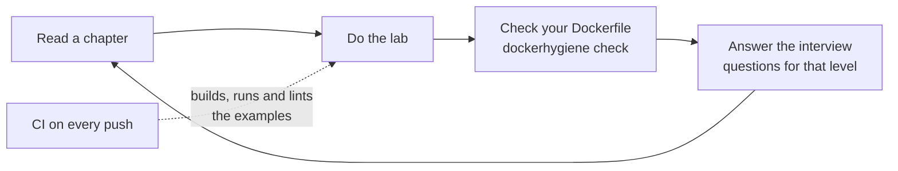

# docker-from-scratch

[](https://github.com/Avinash186200/docker-from-scratch/actions/workflows/ci.yml)
[](LICENSE)


A complete Docker course, from "what is a container" to internals, production
patterns and a real incident. 18 chapters, 8 hands-on labs, 78 interview questions
from basic to advanced, a one-page cheatsheet, and small tested tools that go with
the lessons.

## Scenario

A team is moving its services to containers. Some engineers have never used Docker;
others use it every day but have never had to explain layers, PID 1 or why a laptop
lost 130 GB to it. They need one place to learn it properly, practise it, and check
their own Dockerfiles. That is this repo.

It started from a real problem: my laptop's C: drive hit 0.2 GB free, and Docker
was using 133 GB and had broken itself. The fix and the lessons are in
[chapter 18](docs/chapters/18-case-study-disk-full.md).

## What it covers

| Part | Chapters |
|---|---|
| 1. Basics | [What Docker is, and why](docs/chapters/01-what-is-docker-and-why.md) · [Install and first container](docs/chapters/02-install-and-first-container.md) · [Images, tags, registries](docs/chapters/03-images-and-registries.md) |
| 2. Building images | [Writing a Dockerfile](docs/chapters/04-writing-a-dockerfile.md) · [Layers, cache, image size](docs/chapters/05-layers-cache-and-image-size.md) |
| 3. Running real apps | [Volumes and bind mounts](docs/chapters/06-storage-volumes-and-bind-mounts.md) · [Networking](docs/chapters/07-networking.md) · [Compose](docs/chapters/08-docker-compose.md) · [Config and secrets](docs/chapters/09-configuration-and-secrets.md) · [Logs and debugging](docs/chapters/10-logs-debugging-and-troubleshooting.md) |
| 4. Production | [Resource limits](docs/chapters/11-resource-limits.md) · [Security](docs/chapters/12-security.md) · [CI/CD and tagging](docs/chapters/13-ci-cd-and-tagging.md) · [Production patterns](docs/chapters/14-production-patterns.md) · [Orchestration](docs/chapters/15-orchestration.md) |
| 5. Operations and internals | [Disk space and cleanup](docs/chapters/16-disk-space-and-cleanup.md) · [How Docker works inside](docs/chapters/17-how-docker-works-inside.md) · [Case study: Docker filled my C: drive](docs/chapters/18-case-study-disk-full.md) |

Plus: [labs](labs/README.md) · [interview questions](docs/interview-questions.md) ·
[cheatsheet](docs/cheatsheet.md) · [course map](docs/README.md).

## How it works



The [`examples/`](examples) folder holds one small app and the files the chapters
explain: a production-style [`Dockerfile`](examples/Dockerfile), a
[`multistage.Dockerfile`](examples/multistage.Dockerfile), a deliberately broken
[`bad.Dockerfile`](examples/bad.Dockerfile) for practice, a hardened
[`compose.yaml`](examples/compose.yaml) and a [`daemon.json`](examples/daemon.json)
with log and build-cache limits.

Two small Python tools (standard library only) go with the lessons:

- `dockerhygiene check Dockerfile`: a teaching linter. Each rule maps to a lesson and
  says *why*, not only *what*. CI also runs hadolint, the standard linter.
- `dockerhygiene df`: reads `docker system df` and prints a cleanup plan in the order
  that actually frees space.

And three scripts: a read-only [disk report](scripts/docker-disk-report.sh), a
[cleanup script](scripts/docker-cleanup.sh) that is a dry run unless you pass
`--yes`, and a [PowerShell script](scripts/shrink-docker-vhdx.ps1) that compacts
Docker Desktop's virtual disk on Windows.

## Results

Measured on Docker Desktop 4.90.0 (engine 29.7.2, WSL 2) with the example app.
Commands to reproduce are in the [labs](labs/README.md).

**Base image choice** (lab 2, [chapter 5](docs/chapters/05-layers-cache-and-image-size.md)):

| Image | On disk | Download (compressed) |
|---|---|---|
| Same app on `python:3.11` | 1.6 GB | 410 MB |
| [`examples/Dockerfile`](examples/Dockerfile) on `python:3.11-slim` | 187 MB | 45.6 MB |
| [`examples/multistage.Dockerfile`](examples/multistage.Dockerfile) | 224 MB | 53.3 MB |

The slim base did the work. Multi-stage made *this* image bigger, because a
pure-Python app has no build tools to leave behind. The chapter explains when it
does help.

**Signals and PID 1** (lab 7, [chapter 14](docs/chapters/14-production-patterns.md)):

| CMD form | `docker stop` took | Exit code |
|---|---|---|
| Exec form `["python", "server.py"]` | 0.3 s | 0 (clean shutdown) |
| Shell form `python server.py` | 3.3 s (engine default) | 137 (SIGKILL) |
| Shell form, `docker stop -t 10` | 10.3 s | 137 (SIGKILL) |

**The disk incident** ([chapter 18](docs/chapters/18-case-study-disk-full.md)):

| | Before | After |
|---|---|---|
| C: drive free | 0.2 GB | 159 GB |
| Data inside Docker | 148.7 GB (62 images, 55 stopped containers, 270 volumes, 63.6 GB build cache) | 0 B |
| `docker_data.vhdx` after prune + compact | 129.8 GB → 68.1 GB | → 3.8 GB once `fstrim` ran first |

**Teaching linter** on the broken example:

```
$ python -m dockerhygiene.cli check examples/bad.Dockerfile
examples/bad.Dockerfile:4: DH001 [error] 'python' has no tag, so it means :latest. ...
examples/bad.Dockerfile:4: DH002 [error] The final stage runs as root. ...
examples/bad.Dockerfile:5: DH006 [error] ENV API_KEY puts a secret into the image history ...
... 10 findings, exit code 1. examples/Dockerfile: no findings.
```

## Key concepts

Image vs container · layers and the build cache · multi-stage builds · tags vs
digests · volumes (named vs anonymous) vs bind mounts · user-defined networks and
DNS · Compose project names · secrets at build time vs run time · PID 1 and signals ·
health checks · resource limits and OOM (exit 137) · non-root and capabilities ·
build once, promote by digest · namespaces, cgroups, overlayfs, containerd, OCI ·
Docker Desktop's virtual disk and why it does not shrink.

## Quick start

```bash
git clone https://github.com/Avinash186200/docker-from-scratch.git
cd docker-from-scratch

# the course: start here
# start with docs/README.md (or browse it on GitHub)

# the example app
docker build -t hello-app:1.0 examples
docker run --rm -p 127.0.0.1:8080:8080 hello-app:1.0
curl http://127.0.0.1:8080/

# the tools
pip install -e ".[dev]"
pytest
python -m dockerhygiene.cli check examples/bad.Dockerfile
docker system df | python -m dockerhygiene.cli df
scripts/docker-disk-report.sh
```

## Layout

```
docs/
  README.md                 course map, learning path
  chapters/01..18-*.md      the course
  interview-questions.md    78 questions, basic to advanced
  cheatsheet.md
labs/README.md              8 hands-on labs
examples/                   app, Dockerfiles, compose.yaml, daemon.json
scripts/                    disk report, cleanup (dry run by default), vhdx shrink
src/dockerhygiene/          teaching linter and df cleanup planner
tests/                      pytest, with real 'docker system df' output as fixtures
.github/workflows/ci.yml    tests, hadolint, shellcheck, image build + smoke test
```

## Limitations

- The measurements come from one Windows laptop with Docker Desktop 4.90.0. Sizes
  and timings will differ on other machines and versions; the labs let you measure
  your own.
- The default `docker stop` timeout I measured (about 3 s) is not Docker's documented
  10 s default. I report what I saw and tell you to set the timeout explicitly.
- `dockerhygiene check` is a teaching tool with 11 rules. It is not a replacement for
  hadolint or an image scanner.
- The Windows disk steps (`fstrim` path, `docker_data.vhdx` location) match the
  Docker Desktop version above. Older or newer versions may use other paths; the
  chapter says how to check.
- Kubernetes is covered as a map from Docker concepts, not as a full course.

## License

MIT. See [LICENSE](LICENSE).
