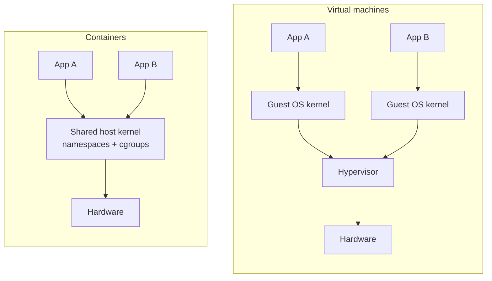

# 1. What Docker is, and why people use it

## The problem it solves

You write an app on your laptop. It works. You give it to a colleague, or put it
on a server, and it breaks: a different Python version, a missing system library,
a different OS, an environment variable nobody wrote down.

Docker fixes this by packing the app **and everything it needs to run** (runtime,
libraries, system packages, config defaults) into one unit called an **image**.
The image runs the same way on your laptop, in CI and on the server.

## Four words you must know

| Word | What it is | Analogy |
|---|---|---|
| **Image** | A read-only template: files + metadata (what command to run, which port, which user). | A class, or a recipe. |
| **Container** | A running (or stopped) instance of an image, with its own writable layer, process, network and filesystem view. | An object made from the class, or a dish made from the recipe. |
| **Dockerfile** | A text file with the steps to build an image. | The source code of the recipe. |
| **Registry** | A server that stores images (Docker Hub, GitHub Container Registry, AWS ECR, Google Artifact Registry...). | A package index, like PyPI or npm. |

One image can start many containers. Deleting a container does not delete the image.

## Containers vs virtual machines

| | Virtual machine | Container |
|---|---|---|
| What is isolated | A full OS with its own kernel | Processes, sharing the host kernel |
| Start time | Tens of seconds to minutes | Usually under a second |
| Size | GBs | MBs to a few hundred MBs |
| Isolation strength | Strong (hardware virtualisation) | Good, but weaker: a kernel bug affects all containers |
| Runs a different OS kernel | Yes | No. Linux containers need a Linux kernel |

That last row matters: on Windows and macOS, Docker Desktop runs a small Linux VM
and your containers run inside it. This is why the disk space story in
[chapter 16](16-disk-space-and-cleanup.md) is different on a laptop.

## Where Docker is used

- **Local development**: start Postgres, Redis or Kafka with one command, no install.
- **Same environment everywhere**: dev, CI and production use the same image.
- **CI/CD**: build once, test the exact image, then deploy that image.
- **Microservices**: each service ships as its own image with its own dependencies.
- **ML and data**: pin CUDA, Python and library versions so a model serves the same
  way it was tested.
- **Orchestration**: Kubernetes, ECS, Cloud Run and others all run container images.

## When Docker is not the answer

- A single static binary or a simple script with no dependencies may not need it.
- GUI desktop apps are awkward in containers.
- Strong multi-tenant isolation (running untrusted code from strangers) needs more
  than plain containers: VMs, gVisor, Firecracker or Kata Containers.
- Docker does not fix bad app design. A stateful app that writes to local disk
  still needs a plan for that data ([chapter 6](06-storage-volumes-and-bind-mounts.md)).

## Docker the company vs Docker the tools vs OCI

"Docker" can mean the company, the CLI, the engine (`dockerd`) or Docker Desktop.
The image and runtime formats are open standards from the **Open Container
Initiative (OCI)**, so an image built with Docker also runs on Podman, containerd
or Kubernetes. More in [chapter 17](17-how-docker-works-inside.md).

## Check yourself

1. What is the difference between an image and a container?
2. Why can't a Linux container run directly on the Windows kernel?
3. Name one case where you would choose a VM over a container.
