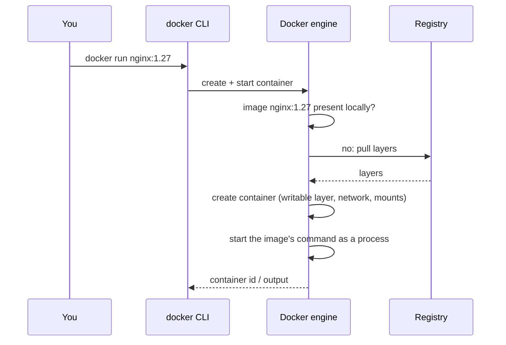

# 2. Install Docker and run your first container

## Install

| OS | What to install | Notes |
|---|---|---|
| Windows 10/11 | Docker Desktop (WSL 2 backend) | Runs a Linux VM through WSL 2. Its disk is a `.vhdx` file under your user profile. |
| macOS | Docker Desktop | Runs a Linux VM. Pick the Apple silicon or Intel build. |
| Linux | Docker Engine (`docker-ce`) from Docker's apt/yum repo | No VM. Data lives in `/var/lib/docker`. |

On Linux, add yourself to the `docker` group to run without `sudo`. Know that
this group is **equal to root** on that machine ([chapter 12](12-security.md)).

Check it works:

```bash
docker version        # client and server (engine) versions
docker info           # storage driver, root dir, number of containers/images
docker run hello-world
```

## What `docker run` actually does



## The commands you will use every day

```bash
# run a web server in the background (-d), name it, publish host port 8080 -> container port 80
docker run -d --name web -p 8080:80 nginx:1.27
# open http://localhost:8080

docker ps               # running containers
docker ps -a            # all containers, including stopped ones
docker logs web         # what the container printed to stdout/stderr
docker logs -f web      # follow, like tail -f
docker exec -it web sh  # open a shell inside the running container
docker stop web         # SIGTERM, then SIGKILL after a grace period
docker start web        # start the same container again (same writable layer)
docker rm web           # delete the container (the image stays)
docker run --rm -it python:3.11-slim python   # throwaway container, removed on exit
```

### Flags worth learning early

| Flag | Meaning |
|---|---|
| `-d` | Detached: run in the background. |
| `-it` | Interactive + a terminal. Use for shells and REPLs. |
| `--name` | A name you can use instead of the id. |
| `-p HOST:CONTAINER` | Publish a port. `-p 127.0.0.1:8080:80` binds only to localhost. |
| `-e KEY=value` | Set an environment variable. |
| `-v` / `--mount` | Attach a volume or bind mount ([chapter 6](06-storage-volumes-and-bind-mounts.md)). |
| `--rm` | Delete the container when it exits. Good habit for one-off commands. |
| `--restart unless-stopped` | Restart on crash or reboot. |

## A common beginner surprise

Every `docker run` creates a **new** container. If you run the same command ten
times without `--rm`, you have ten stopped containers. Each keeps its writable
layer on disk. That is how a laptop ends up with dozens of stopped containers
(the case study had 55). Use `--rm` for throwaway runs, and `docker ps -a` to see
what you have.

## Check yourself

1. What is the difference between `docker stop` + `docker start` and `docker rm` + `docker run`?
2. What does `-p 8080:80` mean, and which side is the container?
3. Why is `--rm` a good default for one-off commands?

Next: [lab 1](../../labs/README.md#lab-1-first-containers).
