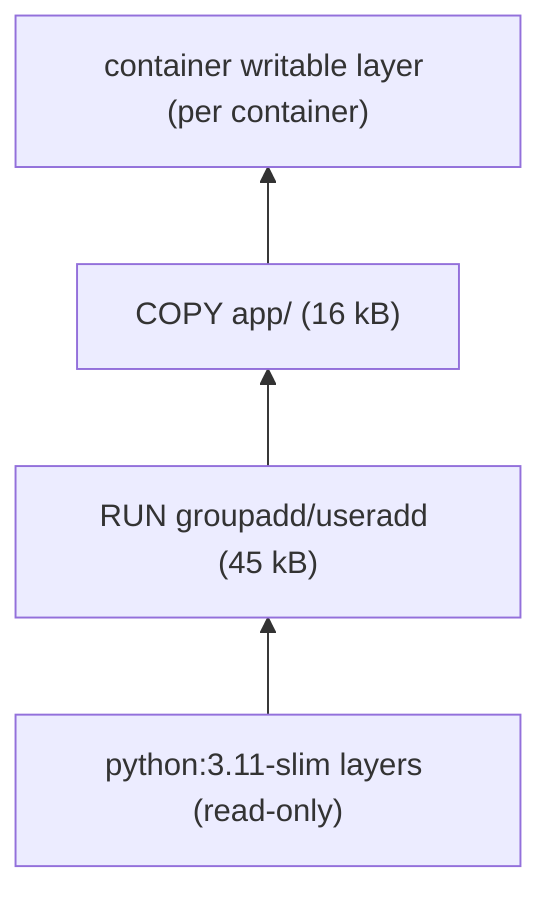

# 5. Layers, the build cache and image size

## Layers

Each `RUN`, `COPY` and `ADD` makes a **layer**: a set of file changes on top of the
layer below. An image is a stack of read-only layers. A container adds one thin
writable layer on top.



Two facts follow from this:

1. **Deleting a file in a later layer does not shrink the image.** The file is still
   in the earlier layer; the later layer only hides it. Clean up in the *same*
   `RUN` that created the files:

   ```dockerfile
   RUN apt-get update \
    && apt-get install -y --no-install-recommends curl \
    && rm -rf /var/lib/apt/lists/*
   ```

2. **Layers are shared.** Ten images on the same base store the base once. This is
   also why `docker system df` can show "reclaimable" numbers that look smaller
   than the sizes: shared layers are still in use.

See the layers of any image with `docker history IMAGE`.

## The build cache

For each instruction, the builder checks: "have I run this exact step, on top of
this exact parent layer, with these exact input files before?" If yes, it reuses
the layer. Once one step misses the cache, **every step after it rebuilds**.

So order your Dockerfile from "changes rarely" to "changes often":

```dockerfile
# bad: any code change re-installs every dependency
COPY . .
RUN pip install --no-cache-dir -r requirements.txt

# good: dependencies are cached until requirements.txt changes
COPY requirements.txt .
RUN pip install --no-cache-dir -r requirements.txt
COPY . .
```

The same idea works for `package.json` + `package-lock.json` then `npm ci`,
`go.mod` + `go.sum` then `go mod download`, and so on.

### BuildKit cache mounts

A cache mount keeps a download cache **between builds** without putting it in the
image:

```dockerfile
RUN --mount=type=cache,target=/root/.cache/pip \
    pip install -r requirements.txt
```

## Multi-stage builds

Use one stage with compilers and build tools, and copy only the result into a
small final stage. The tools never reach the final image.

```dockerfile
FROM golang:1.22 AS build
WORKDIR /src
COPY go.mod go.sum ./
RUN go mod download
COPY . .
RUN CGO_ENABLED=0 go build -o /out/app .

FROM gcr.io/distroless/static:nonroot
COPY --from=build /out/app /app
USER nonroot
ENTRYPOINT ["/app"]
```

The Python version of this pattern is in
[`examples/multistage.Dockerfile`](../../examples/multistage.Dockerfile).

## Choosing a base image

| Base | Size | Has a shell / package manager | Notes |
|---|---|---|---|
| `python:3.11` (Debian full) | Large | Yes | Has compilers and many libraries. Handy for building, heavy for running. |
| `python:3.11-slim` | Small | Yes | A good default for Python apps. |
| `python:3.11-alpine` | Smallest with a shell | Yes (`apk`) | Uses musl, not glibc. Some Python wheels need compiling or behave differently. Test before you choose it. |
| Distroless | Very small | No shell | Less attack surface. Harder to debug: use `docker debug` or a debug variant. |
| `scratch` | Empty | No | For static binaries (Go, Rust). |

## Real numbers from this repo

Measured on Docker Desktop 4.90.0 (engine 29.7.2), with the same tiny app:

| Image | Size on disk (`docker images`) | Download size (`docker image inspect .Size`) |
|---|---|---|
| Built on `python:3.11` (full) | 1.6 GB | 410 MB |
| [`examples/Dockerfile`](../../examples/Dockerfile) on `python:3.11-slim` | 187 MB | 45.6 MB |
| [`examples/multistage.Dockerfile`](../../examples/multistage.Dockerfile) | 224 MB | 53.3 MB |

Two honest lessons:

- Changing the base image did most of the work: about 9x smaller on the wire.
- **Multi-stage made this image bigger**, not smaller. This app needs no compilers,
  so there was nothing to leave behind, and the virtual env added pip and
  setuptools. Multi-stage pays off when the build needs heavy tools (compilers,
  `-dev` packages, Node for a front-end build). Measure; don't assume.

Reproduce with [lab 2](../../labs/README.md#lab-2-build-your-own-image).

## Check yourself

1. Why does `RUN rm -rf /var/lib/apt/lists/*` in its own layer not save space?
2. You changed one line of code and the build re-installed all dependencies. Why?
3. When does a multi-stage build *not* make an image smaller?
