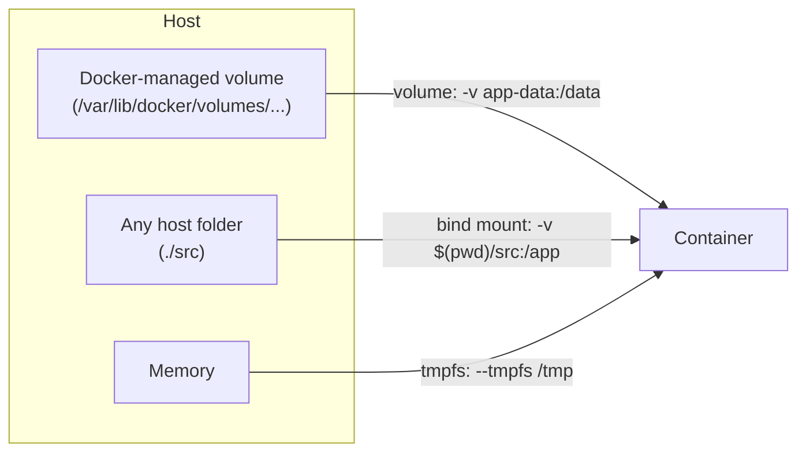

# 6. Storage: volumes, bind mounts and tmpfs

## The container's own filesystem is temporary

Files a container writes go into its **writable layer**. They survive
`docker stop` / `docker start`, but they are gone when the container is removed
(`docker rm`, `docker compose down`, or a new deploy). Never keep data you care
about only there.

## Three ways to mount storage



| Type | Use it for | Watch out |
|---|---|---|
| **Named volume** (`-v app-data:/data`) | Databases and any app data in Docker. Docker manages where it lives. | Easy to forget it exists. It outlives the container on purpose. |
| **Anonymous volume** (a `VOLUME` line in the image, or `-v /data`) | Rarely what you want. | Gets a random 64-character name. A new one per container. This is how hundreds of them pile up. |
| **Bind mount** (`-v /host/path:/container/path`) | Local development: edit code on the host, see it in the container. Config files. | Host paths and permissions leak in. On Windows/macOS it is slower (files cross the VM boundary). |
| **tmpfs** (`--tmpfs /tmp`) | Scratch files, secrets that should never touch disk. | Lost on stop; uses RAM. |

`--mount` is the longer, more explicit syntax and fails loudly on typos:

```bash
docker run --mount type=volume,src=app-data,dst=/data hello-app:1.0
docker run --mount type=bind,src="$(pwd)"/config,dst=/config,readonly hello-app:1.0
```

## Volume commands

```bash
docker volume ls
docker volume ls -f dangling=true     # not used by any container
docker volume inspect app-data
docker volume rm app-data
docker volume prune                   # Docker 23+: anonymous unused volumes only
docker volume prune -a                # ALL unused volumes, named ones too (databases!)
```

The change in Docker Engine 23 matters in interviews and in real life:
`volume prune` used to remove every unused volume; now it only removes anonymous
ones unless you add `-a`. In the [case study](18-case-study-disk-full.md), 260 of
270 volumes were anonymous leftovers from test runs.

## Permissions

If the container runs as user 10001 and writes to a volume, the folder must be
writable by 10001. A **new, empty named volume** is filled with the image's
contents at that path, ownership included. That is why the example Dockerfile does
`mkdir -p /data && chown app:app /data` before `USER 10001:10001`. With bind mounts, the
host folder's owner wins, so match the user id or set permissions on the host.

## Backing up a volume

```bash
docker run --rm -v app-data:/data:ro -v "$(pwd)":/backup alpine:3.20 \
  tar czf /backup/app-data.tgz -C /data .
```

For databases, prefer the database's own tool (`pg_dump`), because copying files of
a running database can give you a broken copy.

## Check yourself

1. You ran `docker rm` on your Postgres container. Is the data gone?
2. Why did one laptop end up with 260 unnamed volumes?
3. Why is a bind mount slower on Docker Desktop than on Linux?

Next: [lab 4](../../labs/README.md#lab-4-volumes-keep-data).
