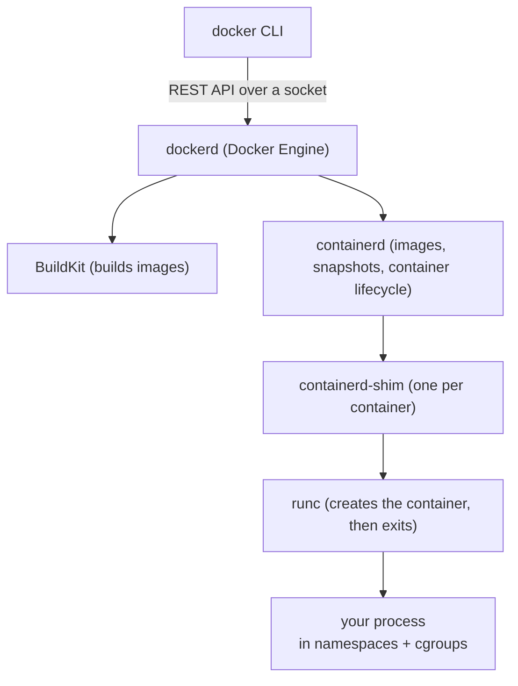

# 17. How Docker works inside

## The stack



- The **CLI** is only a client. `docker -H ssh://user@server ps` talks to a remote engine.
- **dockerd** handles the API, networks, volumes and builds.
- **containerd** manages images and running containers. Kubernetes talks to it directly.
- **runc** is the low-level OCI runtime that sets up the kernel features below.

## The kernel features

A container is a normal Linux process with limits on what it can see and use.

| Feature | What it gives the container |
|---|---|
| **Namespaces** | Its own view: `pid` (own PID 1), `net` (own interfaces, own localhost), `mnt` (own filesystem tree), `uts` (own hostname), `ipc`, `user` (map root inside to a normal user outside). |
| **cgroups** | Limits and accounting: memory, CPU, PIDs, I/O ([chapter 11](11-resource-limits.md)). |
| **Union filesystem (overlayfs)** | Stacks read-only image layers plus a writable layer into one tree ([chapter 5](05-layers-cache-and-image-size.md)). Writes use copy-on-write. |
| **Capabilities, seccomp, AppArmor/SELinux** | Remove powers from "root" inside and block risky system calls ([chapter 12](12-security.md)). |

You can see it from the host on Linux:

```bash
docker run -d --name sleeper alpine:3.20 sleep 1000
ps -ef | grep "sleep 1000"          # a normal process on the host
docker top sleeper                  # same process, as Docker sees it
sudo ls -l /proc/$(docker inspect -f '{{.State.Pid}}' sleeper)/ns   # its namespaces
docker rm -f sleeper
```

## OCI: the open standards

- **Image spec**: an image is a manifest (JSON) listing a config and layer
  tarballs, each addressed by SHA-256 digest.
- **Runtime spec**: how to run a filesystem bundle with a config (runc implements it).
- **Distribution spec**: how registries serve images over HTTP.

Because of these, Docker, Podman, containerd, CRI-O and Kubernetes all share images.

## Docker Desktop on Windows and macOS

Docker Desktop runs a small Linux VM (WSL 2 on Windows, a lightweight VM on macOS).
`dockerd` and every container run inside it. Your `docker` CLI on the host talks to
the engine in the VM. Consequences:

- Bind mounts cross the VM boundary, so they are slower.
- The VM has its own CPU, memory and disk budget.
- All images, containers and volumes live in one virtual disk file on the host
  drive. When the host drive is full, that file cannot grow, and the filesystem
  inside can fail. That is exactly what happened in the
  [case study](18-case-study-disk-full.md).

## Check yourself

1. Which kernel feature makes `localhost` inside a container different from the host's?
2. Which one stops a container from using all the memory?
3. Why can an image built by Docker run on Kubernetes with containerd?
