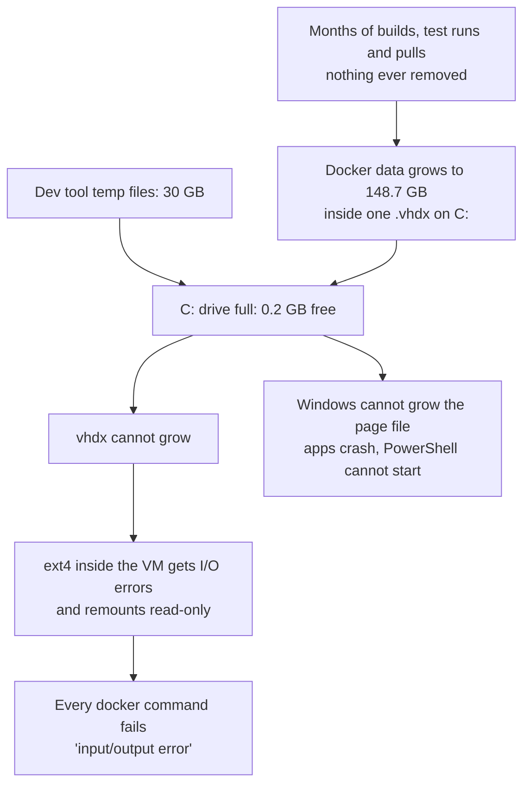

# 18. Case study: the day Docker filled my C: drive

This is a real incident from my Windows 11 dev laptop (Docker Desktop 4.90.0,
WSL 2 backend, engine 29.7.2). All numbers are copied from the commands I ran.

## Summary

| | Before | After |
|---|---|---|
| C: drive free | **0.2 GB** of 335 GB | **159 GB** |
| Data inside Docker (`docker system df`) | 148.7 GB | 0 B |
| Docker's virtual disk file (`docker_data.vhdx`) | 129.8 GB | **3.8 GB** |

## What I saw

- VS Code kept closing on its own.
- PowerShell would not even start a command. It failed with
  `Failed to create CoreCLR, HRESULT: 0x8007000E` (out of memory). With the disk
  full, Windows most likely could not grow its page file, so new processes could
  not get memory.
- Every `docker images` / `docker system df` failed with
  `input/output error` reading files under `/var/lib/desktop-containerd/...`.

## Timeline

1. **Find the big folders.** The user temp folder was 30 GB (old video-render
   thumbnails and test caches from dev tools). Docker's data folder was 133 GB.
2. **Quick wins first.** I deleted only caches that rebuild themselves: thumbnail
   caches, jest and node compile caches, old render temp folders, npm and uv
   package caches. C: went from 0.2 GB to 32 GB free. The machine was usable again.
3. **Docker would not answer.** Inside the Docker VM, the data disk was mounted
   read-only in emergency mode after repeated ext4 errors (`I/O error`,
   `error -5 reading directory block`). Prune commands cannot free anything on a
   read-only filesystem. The physical SSD reported healthy and Windows had no disk
   errors, so the likely cause was the virtual disk failing to grow while the host
   drive was full.
4. **Restart, then check health.** I quit Docker Desktop, ran `wsl --shutdown`
   and started it again. The disk mounted read-write and the I/O error count was 0.
   Now `docker system df` worked:

   ```
   TYPE            TOTAL     ACTIVE    SIZE      RECLAIMABLE
   Images          62        17        56.52GB   22.99GB (40%)
   Containers      55        0         3.346GB   3.346GB (100%)
   Local Volumes   270       10        25.21GB   24.56GB (97%)
   Build Cache     517       0         63.6GB    7.755GB
   ```

5. **Decide what is safe, before deleting.** I went through it item by item:
   - 55 stopped containers: leftovers from test runs. Two "running" ones were test
     shells I had started that morning, with nothing stored inside.
   - 260 of 270 volumes were **anonymous**, created by test runs over three weeks.
   - The named volumes were the same local stack under **three Compose project
     names**: the old folder name, the new folder name, and a review copy. The real
     dev and production databases live in a managed cloud database, so the local
     copies were disposable.
   - Images and build cache can always be pulled or rebuilt.
6. **Prune, in order.**

   | Command | Reclaimed |
   |---|---|
   | `docker container prune -f` | 3.346 GB |
   | `docker volume prune -a -f` | 25.21 GB |
   | `docker image prune -a -f` | 44.08 GB |
   | `docker builder prune -a -f` | 63.6 GB |

7. **The host did not get the space back.** Docker was now empty, but
   `docker_data.vhdx` was still 129.8 GB. I stopped Docker and WSL and ran
   `Optimize-VHD -Mode Full` as admin: **68.1 GB**. Better, but Docker was empty.
8. **Trim, then compact again.** With Docker running, `fstrim -v` on the data disk
   told the virtual disk which blocks were free (only 1.6 GB was really in use).
   Then I stopped everything and compacted again: **3.8 GB**. C: had 159 GB free.

## Root cause



The real cause was not one big thing. It was many small things that nobody
cleaned up: 55 stopped containers, 260 anonymous volumes, three copies of one
stack, 63.6 GB of build cache, on the system drive, with no limit.

## Things I learned

1. **Docker never cleans up on its own.** Except for build cache GC, everything
   stays until you remove it.
2. **Stopped containers hide how much you can free.** "Reclaimable" for images was
   23 GB of 56.5 GB; after removing the stopped containers, all of it could go.
3. **`volume prune` changed in Docker 23.** It removes only anonymous volumes now.
   Named volumes need `-a`, and that is where databases live, so check first.
4. **Build cache GC was on and still grew.** Docker Desktop's default config already
   had `builder.gc` enabled with a 20 GB budget, yet build cache showed 63.6 GB, of
   which only 7.8 GB was reclaimable while images still used it. Do not assume the
   default policy keeps you safe; look at `docker system df`.
5. **On Docker Desktop, pruning is half the job.** The virtual disk file only
   shrinks when you compact it, and compaction works much better after `fstrim`
   (68.1 GB without it, 3.8 GB with it).
6. **Compose project names matter.** Renaming or copying a project folder silently
   makes a new set of volumes. Set `name:` in `compose.yaml`.
7. **A full system drive breaks more than Docker.** Editors, shells and the page
   file all fail. Keep the Docker disk off the system drive, and cap its size.
8. **Fix the filesystem before you clean it.** When Docker returns I/O errors, a
   restart (or a purge, if errors come back) comes before any prune.

## What to change so it does not happen again

- Move the Docker disk image to the data drive (Settings → Resources → Advanced).
- `--rm` for one-off runs; `name:` in every Compose file.
- Log limits and a build cache budget in `daemon.json`
  ([`examples/daemon.json`](../../examples/daemon.json)).
- A weekly `scripts/docker-disk-report.sh`, and `scripts/docker-cleanup.sh` when it
  looks big.

## How I tell this story in an interview

"My laptop's C: drive hit zero free space. VS Code kept crashing and even
PowerShell could not start. I first freed about 30 GB of safe caches so the machine
worked again. Then I found Docker was using 133 GB, but Docker itself was broken:
every command gave an input/output error, because its virtual disk could not grow
and Linux had made it read-only.

I restarted Docker and WSL, checked the disk was healthy again, and only then
looked at what was inside: 55 stopped containers, 270 volumes, 260 of them
anonymous, the same stack under three project names, and 63 GB of build cache. I
checked each named volume was not the only copy of real data, then pruned
containers, volumes, images and build cache.

Docker was empty but the disk file was still 130 GB, because on Windows the
virtual disk does not shrink by itself. Compacting it only got to 68 GB. When I ran
fstrim inside the VM first, the same compaction got it to under 4 GB. In the end C:
went from 0.2 GB to 159 GB free.

The lessons: keep the Docker disk off the system drive, set log and build cache
limits, give Compose projects a fixed name, and check `docker system df` every
week instead of waiting for the drive to fill."
